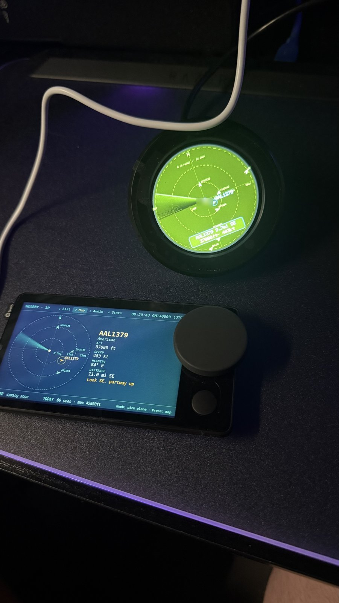
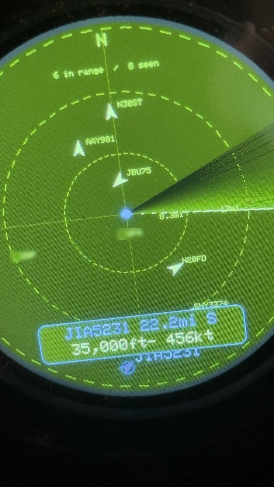
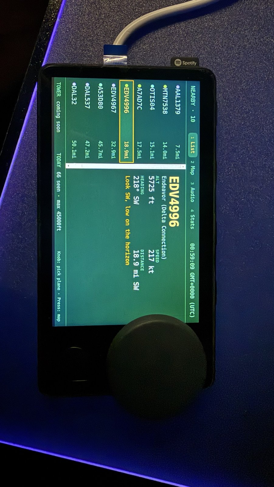
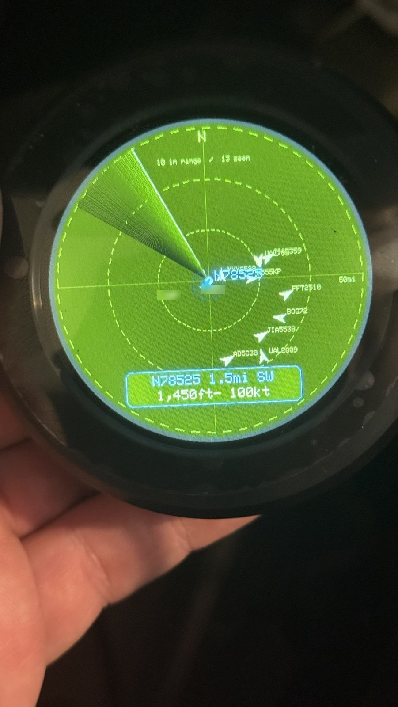
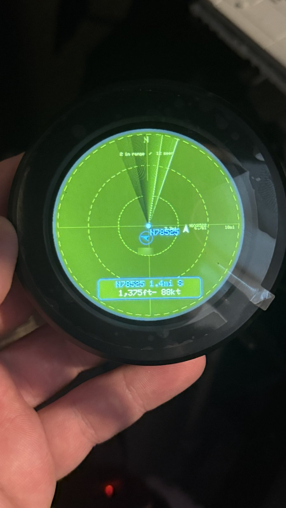
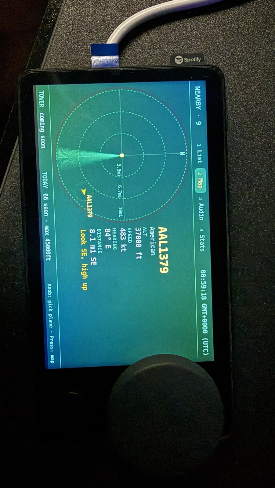
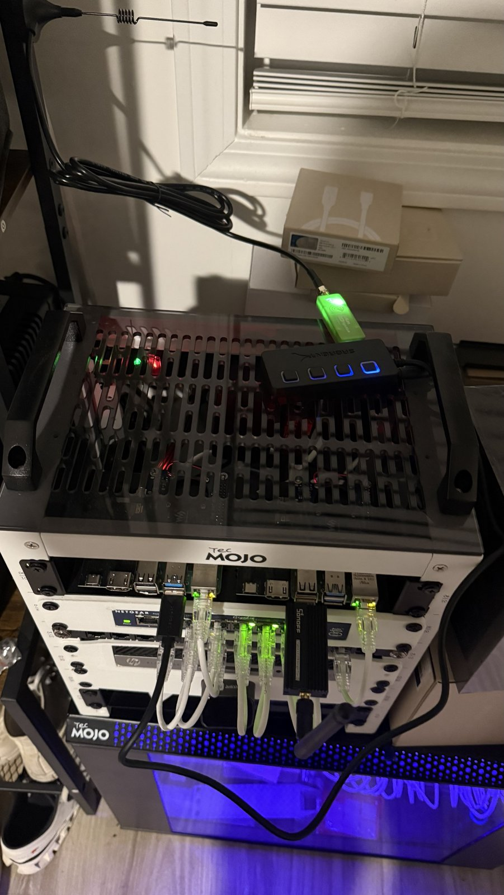

# Plane Radar

A home-built radar for the planes flying over your house. A Raspberry Pi with a USB radio picks up the position signals planes broadcast (ADS-B, 1090 MHz), and shows them on:

- a **round ESP32-S3 desk display** with a sweeping radar scope and a rotary knob to zoom and pick planes
- a **Spotify Car Thing** (through DeskThing) with a plane list, a map, tower audio controls and stats
- **Home Assistant**: a radar card, sensors, a sightings log and Pi health alerts

A second USB radio adds **live air traffic control audio** (tower, approach, center), which you can switch between presets from Home Assistant or the Car Thing.

<p align="center">
  
  
  
</p>

## What's in here

| Folder | What it is |
|---|---|
| `firmware/` | Arduino sketch for the Elecrow 2.1" round ESP32-S3 rotary display |
| `carthing-app/` | DeskThing app for the Spotify Car Thing (list, map, audio, stats) |
| `pi/` | Install scripts for the Raspberry Pi: tower radio, tuner service, aircraft database, sightings log, Pi health |
| `homeassistant/` | Home Assistant packages, a custom radar card, and a tower radio player page |
| `docs/photos/` | Photos of the build |

## Parts

| Part | Job | Approx. price |
|---|---|---|
| Raspberry Pi 4 Model B + microSD card (32 GB+) | Runs everything | — |
| ADS-B USB receiver (e.g. FlightAware/AirNav FlightStick) | Picks up plane positions on 1090 MHz | $50 |
| 1090 MHz antenna (e.g. Bingfu 6 dBi magnetic) | Antenna for the plane receiver | $10 |
| RTL-SDR stick (e.g. Nooelec NESDR Smart v5) + telescopic antenna | Tower audio (118–137 MHz). *Optional* | $55 |
| Powered USB hub | Two radios draw more power than a Pi likes to give | $20 |
| Elecrow 2.1" ESP32-S3 rotary round display (480×480) | Desk radar screen. *Optional* | $45 |
| Spotify Car Thing running DeskThing | Control panel. *Optional* | — |

## Quick start

Don't want to build anything? Ready-made files for the Car Thing app and the round display are in [`downloads/`](downloads/).

## Setup

You'll need to be comfortable copying files to a Pi and running a few commands. Each step says what to change.

### 1. Plane tracking on the Pi

1. Flash **Raspberry Pi OS Lite (64-bit)** with Raspberry Pi Imager. Turn on SSH and give it a hostname.
2. Install **readsb** and **tar1090** with wiedehopf's scripts (see [adsb-scripts](https://github.com/wiedehopf/adsb-scripts) and [tar1090](https://github.com/wiedehopf/tar1090)), and set your receiver location when it asks. Your location only stays on your Pi.
3. Check `http://<your-pi>/tar1090/` shows planes.
4. Give the Pi a fixed address in your router (a DHCP reservation), so the screens can always find it.

### 2. Extras on the Pi (`pi/` folder)

Copy the `pi` folder to the Pi, then run whichever you want with `sudo bash <script>`:

| Script | What it adds |
|---|---|
| `install-aircraft-db.sh` | Tail numbers and aircraft types for every plane (refreshes monthly) |
| `install-pistats.sh` | Pi health (temperature, CPU, disk, power) for Home Assistant |
| `install-sightings.sh` | A log of every plane seen, kept for one year (port 8092: `/plane?hex=`, `/regulars`, `/recent`, `/stats`) |
| `install-tower-radio.sh` | Tower audio with a second radio. **First** set `AIR_SERIAL` at the top (the script explains how to find it) and edit `presets.sh` for your own airports, using the frequencies on airnav.com |

Tower radio tuner (port 8091): `/status`, `/tune?preset=ID`, `/levels` (signal meter), `/squelch?db=8`, `/gain?db=20`. The stream is at `http://<your-pi>:8000/radio.mp3`.

**Antenna tips:** height and distance from Wi-Fi gear matter more than anything else. Stand antennas straight up near a window, away from access points and computers. If tower audio is hissy, lower the gain (`/gain?db=16.6`) and set a squelch (`/squelch?db=8`). The `/levels` meter shows the effect in numbers.

### 3. Round display (`firmware/`)

1. Install Arduino IDE (or arduino-cli) with the **esp32 by Espressif** board package (3.x), plus the libraries **WiFiManager**, **ArduinoJson**, **GFX Library for Arduino** and **PCF8574**.
2. Board settings: ESP32S3 Dev Module, Flash 16MB, PSRAM **OPI**, Partition **16M Flash (3MB APP/9.9MB FATFS)**, USB CDC On Boot **Enabled**.
3. Change the nearby `AIRPORTS` near the top of `PlaneRadar.ino` to your own, then upload.
4. On first start it makes a Wi-Fi hotspot called **PlaneRadar-Setup**. Join it from your phone, pick your Wi-Fi, and type your Pi's address.

Turn the knob to zoom (5 / 10 / 25 / 50 / 100 miles), click it to highlight the next plane, and double-click to swap red and blue if the colors look wrong.

### 4. Car Thing (`carthing-app/`)

1. Install [DeskThing](https://github.com/ItsRiprod/DeskThing) on your computer and set up the Car Thing with it.
2. Build the app: `cd carthing-app && npm install && npm run build`. That makes a zip in `dist/`.
3. In DeskThing: **Apps → Upload App**, then pick the zip.
4. In the app's settings in DeskThing, set **Pi address** to your Pi.

The Car Thing has no speaker, so **Play on PC** plays the tower audio on the computer running DeskThing.

### 5. Home Assistant (`homeassistant/`)

1. In `configuration.yaml`, enable packages:
   ```yaml
   homeassistant:
     packages: !include_dir_named packages
   ```
2. Copy `packages/*.yaml` to `/config/packages/`, `fetch.py` to `/config/planeradar/`, and `planeradar-card.js` plus `www/tower-radio.html` to `/config/www/`.
3. **Find and replace** `YOUR_PI_IP` with your Pi's address in every file, and `mobile_app_YOUR_PHONE` with your phone's notify service (Developer tools → Actions, search "notify.mobile_app").
4. `ha_pi_health.yaml` watches the Home Assistant Pi itself and needs the **System Monitor** and **Raspberry Pi Power Supply Checker** integrations. Skip it if you don't want that.
5. Add the card as a dashboard resource (`/local/planeradar-card.js`, type JavaScript module), then:
   ```yaml
   type: custom:planeradar-card
   range: 25
   map_url: http://YOUR_PI_IP/tar1090/
   ```
   And for tower audio, an iframe card: `type: iframe` with `url: /local/tower-radio.html`.
6. Restart Home Assistant.
7. **Want the whole Planes tab in one go?** Use [`homeassistant/dashboard-planes.yaml`](homeassistant/dashboard-planes.yaml): open your dashboard → pencil (Edit) → **+** to add a view → three dots → **Edit in YAML**, paste the file in, change `YOUR_PI_IP`, and save. You get the radar, plane stats, Pi health and the tower radio picker (from `packages/tower_radio.yaml`) laid out like the photos.

**Sharing with flight-tracking networks (optional):** your Pi can also feed community and commercial networks. Each one is separate, so set up only the ones you want. `pi/install-pistats.sh` reports adsb.fi's status to Home Assistant, and the FR24 block in `planeradar.yaml` reads Flightradar24's local status page. Both have a "down for 15 minutes" alert. With MLAT off, the location you give a network only affects its range stats, not plane positions, so you can use an approximate spot for privacy.

**Fun extras:** the **Overhead** tile says "No" most of the time and "Look up or duck!" when a plane is right above you. Temperatures show in whatever unit you pick for each sensor (entity settings → unit). The alerts convert on their own and trigger at 70 °C / 158 °F.

## Privacy note

Everything runs on your own network. The plane data comes from your own antenna, and nothing is uploaded anywhere unless you choose to feed a flight-tracking site. Your receiver location lives only on your Pi.

## More photos

<p align="center">
  
  
  
  
</p>

## Credits

Built on [readsb](https://github.com/wiedehopf/readsb), [tar1090](https://github.com/wiedehopf/tar1090) and its [aircraft database](https://github.com/wiedehopf/tar1090-db), [RTLSDR-Airband](https://github.com/rtl-airband/RTLSDR-Airband), [Icecast](https://icecast.org), [DeskThing](https://github.com/ItsRiprod/DeskThing) and [Home Assistant](https://www.home-assistant.io). Thank you to all of them.

## License

MIT. See [LICENSE](LICENSE).
